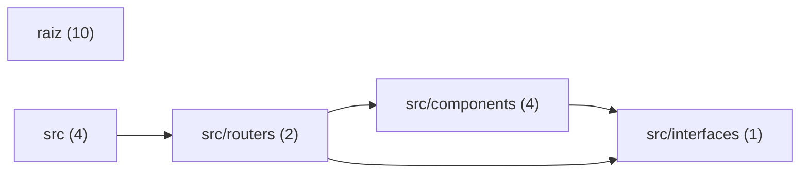

# Documentação: Listar rango

> Gerada pela Neurok a partir do commit `39ed224` de lucazin/listar-rango (2026-10-08).

## Sumário
1. [Visão geral](#visão-geral)
2. [Como rodar](#como-rodar)
3. [Arquitetura](#arquitetura)
4. [Os módulos e os arquivos principais](#os-módulos-e-os-arquivos-principais)
5. [A API](#a-api)
6. [O modelo de dados](#o-modelo-de-dados)
7. [Os fluxos principais](#os-fluxos-principais)
8. [Configuração](#configuração)
9. [Glossário](#glossário)
10. [Riscos e pontos de atenção](#riscos-e-pontos-de-atenção)

## Visão geral

Esta é uma aplicação Web responsiva desenvolvida em React, TypeScript, Vite e Tailwind CSS para um desafio técnico da Goomer. O projeto consulta dados de restaurantes e cardápios e apresenta essas informações em três níveis principais:

- Lista de restaurantes.
- Detalhes de cada restaurante, incluindo seus horários.
- Itens disponíveis no cardápio.

Como a API original estava fora do ar, os dados são disponibilizados a partir de `db.json` usando `my-json-server`.

### Funcionalidades

A aplicação permite que os usuários:

- Encontrem restaurantes.
- Consultem os horários de funcionamento.
- Visualizem os itens dos cardápios.
- Filtrem restaurantes e itens.
- Abram os detalhes de um item.
- Ajustem a quantidade do item em um modal.

### Tecnologias

O código utiliza as seguintes linguagens e tecnologias:

- Linguagens e formatos: JSON, TypeScript, JavaScript, Markdown, HTML e CSS.
- Tecnologias: React, Tailwind CSS, TypeScript e Vite.

A implementação analisada corresponde ao repositório `lucazin/listar-rango`. Foram lidos 21 arquivos, totalizando 1273 linhas.

## Como rodar

### Execução local

Os scripts disponíveis estão declarados em `package.json`:

- `npm run dev`: inicia o Vite para desenvolvimento.
- `npm run db`: inicia o `json-server` observando `db.json`.
- `npm run build`: executa `tsc` e, em seguida, `vite build`.
- `npm run start`: executa o comando `dist`.
- `npm run lint`: executa o ESLint nos arquivos com extensões `.ts` e `.tsx`, com `--report-unused-disable-directives` e `--max-warnings 0`.
- `npm run preview`: inicia o preview do Vite.

O projeto usa React, Tailwind CSS, TypeScript e Vite. Os pontos de entrada informados são `src/main.tsx` e `src/interfaces/index.ts`.

### Variáveis de ambiente

Não foram encontradas variáveis de ambiente lidas pelo código nem arquivos de exemplo de ambiente.

### Build e validação

Para gerar a build, use `npm run build`. O script executa primeiro a verificação do TypeScript com `tsc` e depois a construção com `vite build`.

Para validar o código, use `npm run lint`. O comando falha quando há avisos, devido à opção `--max-warnings 0`.

Os comandos e scripts detalhados estão na tabela a seguir.

| Script | Comando | Onde |
|---|---|---|
| `dev` | `vite` | `package.json` |
| `db` | `json-server --watch db.json` | `package.json` |
| `build` | `tsc && vite build` | `package.json` |
| `start` | `dist` | `package.json` |
| `lint` | `eslint . --ext ts,tsx --report-unused-disable-directives --max-warnings 0` | `package.json` |
| `preview` | `vite preview` | `package.json` |

## Arquitetura

### Visão geral

A arquitetura está organizada em torno de `src`, com separação entre entrada da aplicação, roteamento, componentes visuais e contratos TypeScript. Na raiz do projeto ficam as configurações de Vite, TypeScript, Tailwind CSS e ESLint, além dos scripts do projeto e dos dados estáticos usados como API.

O diretório `src` reúne a entrada da aplicação, o componente principal e os estilos globais. Ele também se relaciona com `src/routers`, que concentra a implementação das telas e dos loaders de dados.

### Responsabilidades por módulo

- `src/routers` implementa as telas de listagem de restaurantes e de detalhes de um restaurante. Também contém os loaders de dados.
- `src/components` fornece componentes visuais reutilizáveis para busca, cartões de restaurante, cartões de cardápio e modal.
- `src/interfaces` define as interfaces TypeScript usadas por restaurantes, cardápios, horários, vendas e propriedades dos componentes.

Os componentes reutilizáveis dependem das interfaces definidas em `src/interfaces`. Os routers usam tanto os componentes de `src/components` quanto os contratos de `src/interfaces`, enquanto `src` usa os routers para compor a aplicação.

### Fluxo de imports

O fluxo de dependências identificado no código é:

- `src` importa `src/routers` em 2 ocorrências.
- `src/routers` importa `src/components` em 5 ocorrências.
- `src/routers` importa `src/interfaces` em 2 ocorrências.
- `src/components` importa `src/interfaces` em 4 ocorrências.

Não foram identificados imports de `src/interfaces` para outros módulos na síntese analisada.

### Pontos de entrada

Foram identificados dois pontos de entrada:

- `src/main.tsx`
- `src/interfaces/index.ts`

`src/main.tsx` é a entrada da aplicação. `src/interfaces/index.ts` concentra a entrada das definições de interfaces TypeScript.

| Módulo | Arquivos | O que faz | Conversa com |
|---|---|---|---|
| `(raiz)` | 10 | Contém a configuração do Vite, TypeScript, Tailwind CSS, ESLint, scripts do projeto e os dados estáticos usados como API. |  |
| `src` | 4 | Reúne a entrada da aplicação, o componente principal e os estilos globais. | `src/routers` |
| `src/components` | 4 | Contém os componentes visuais reutilizáveis para busca, cartões de restaurante, cartões de cardápio e modal. | `src/interfaces` |
| `src/routers` | 2 | Implementa as telas de listagem de restaurantes e de detalhes de um restaurante, além dos loaders de dados. | `src/components`, `src/interfaces` |
| `src/interfaces` | 1 | Define as interfaces TypeScript para restaurantes, cardápios, horários, vendas e propriedades dos componentes. |  |

## Os módulos e os arquivos principais

### Pontos de entrada e fluxo principal

- `index.html` é o documento HTML inicial. Ele define os metadados, carrega a fonte Montserrat, referencia `/src/main.tsx` e fornece o elemento `#root` usado para montar a aplicação React.
- `src/main.tsx` configura o roteador e o renderiza no elemento `#root`. A rota `/` exibe `ListRestaurants` com seu carregador de dados, enquanto `/restaurant/:id` exibe `RestaurantPage` com o carregador correspondente. O arquivo expõe `router`.
- `src/App.tsx` define o componente `App`, que renderiza uma `
` com o texto `App`. O componente é exportado como padrão, mas o ponto de montagem e as rotas principais são definidos em `src/main.tsx`.

### Modelo de dados

- `src/interfaces/index.ts` centraliza as interfaces TypeScript usadas pelo projeto. O arquivo representa restaurantes, cardápios, horários, vendas e propriedades de componentes, além de exportar os tipos para uso em outros módulos.
- `db.json` fornece os dados estáticos de restaurantes e itens de menu. Os restaurantes possuem identificação, nome, endereço, imagem e horários de funcionamento. Os menus referenciam o restaurante por `restaurantId` e informam nome, imagem, preços, grupo e condições de venda.

As principais interfaces expostas por `src/interfaces/index.ts` são `Hours`, `PropsCardListRestaurant`, `PropsSearch`, `Restaurant`, `PropsCardCardapio`, `TextHours`, `Menus` e `LoaderRestaurant`. Os campos de dados correspondentes em `db.json` incluem `restaurants`, `menus`, `restaurantId`, `hours` e `sales`.

### Telas e carregamento de dados

- `src/routers/ListRestaurants.tsx` define a tela de listagem de restaurantes. O módulo carrega os dados de um arquivo JSON remoto, exibe os restaurantes em cartões e permite filtrá-los por nome. Também exporta `LoaderList`, usado pela rota da listagem, e `ListRestaurants`.
- `src/routers/Restaurant.tsx` define a página individual de restaurante. Seu loader busca restaurantes e menus no arquivo `db.json` remoto. A tela exibe os dados do restaurante e seus horários, permite buscar itens do cardápio, organiza os itens em grupos expansíveis e apresenta um modal. O módulo expõe `RestaurantLoader` e `RestaurantPage`.

### Componentes de interface

- `src/components/Search.tsx` define `Search`, um campo de busca controlado. O componente mantém o texto digitado em estado local, exibe um placeholder, chama `fillterList` quando o texto muda, impede o envio padrão do formulário e exibe um ícone de busca.
- `src/components/CardListRestaurant.tsx` define `CardListRestaurant`, o cartão de restaurante. Ele exibe nome, endereço, logo padrão e o status de aberto ou fechado conforme o dia atual. O cartão navega para `/restaurant/${restaurant.id}`.
- `src/components/CardCardapio.tsx` define `CardCardapio`, o card de um item do cardápio. O componente exibe a imagem padrão, o nome, a descrição e os preços de `menu`, além de chamar `menuModal` quando o card é clicado.
- `src/components/Modal.tsx` define `Modal` e `handleSetValue`. O modal exibe os detalhes de um item do menu e usa o hash da URL para controlar sua visibilidade. Também permite aumentar ou diminuir a quantidade e calcula o total com base no preço da primeira opção de venda.

### Estilos e configuração de interface

- `src/index.css` carrega as camadas base, de componentes e de utilitários do Tailwind CSS. Também define a classe reutilizável `.shadow-box`, responsável por aplicar uma sombra de caixa.
- `tailwind.config.js` configura os caminhos em que o Tailwind procura classes, abrangendo arquivos HTML, JavaScript, TypeScript, JSX e TSX. O arquivo também define `fontFamily.mont`, com Montserrat e fallback para `sans-serif`.
- `postcss.config.js` configura o PostCSS com Tailwind CSS e Autoprefixer.

### Configuração de desenvolvimento

- `package.json` define os metadados do projeto `goomer`, seus scripts e suas dependências. Também especifica o uso de módulos ES e Node.js 18. Os scripts expostos são `dev`, `db`, `build`, `start`, `lint` e `preview`.
- `vite.config.ts` configura o Vite com o plugin do React e exporta a configuração padrão por meio de `defineConfig`.
- `tsconfig.json` configura o compilador TypeScript para o código em `src`, com suporte a ES2020, DOM, módulos ESNext, JSX via `react-jsx` e resolução de módulos no modo bundler. O arquivo também habilita a checagem estrita e referencia `tsconfig.node.json`.
- `tsconfig.node.json` define a configuração TypeScript do arquivo de configuração do Vite e mantém `vite.config.ts` como único arquivo no escopo dessa configuração.
- `src/vite-env.d.ts` inclui as definições de tipos fornecidas pelo cliente do Vite.
- `.eslintrc.cjs` configura o ESLint com ambientes, regras recomendadas, parser TypeScript, plugin do React Refresh e arquivos ignorados na análise.

### Documentação do projeto

- `README.md` documenta o projeto Listar rango, incluindo o desafio técnico, o objetivo da aplicação, as tecnologias e bibliotecas utilizadas. O arquivo também fornece links para o repositório do desafio, o projeto finalizado, uma demonstração visual e a API usada durante o desenvolvimento.

| Arquivo | Papel | O que faz |
|---|---|---|
| `src/interfaces/index.ts` | modelo_de_dados | Define as interfaces TypeScript usadas para representar restaurantes, cardápios, horários, vendas e propriedades de componentes. Também exporta essas interfaces para uso em outros arquivos do projeto. |
| `src/main.tsx` | rota | Configura as rotas principais da aplicação e renderiza o roteador no elemento HTML com id `root`. A rota `/` exibe a lista de restaurantes e a rota `/restaurant/:id` exibe uma página de restaurante, cada uma com seu respectivo carregador de dados. |
| `src/components/Search.tsx` | componente | Define um campo de busca controlado que exibe um placeholder, mantém o texto digitado em estado local e chama `fillterList` sempre que o texto muda. O formulário impede o envio padrão e exibe um ícone de busca. |
| `src/components/CardCardapio.tsx` | componente | Define um card de item do cardápio. Ele exibe a imagem padrão, o nome, a descrição e os preços de `menu`, e chama `menuModal` ao ser clicado. |
| `src/components/CardListRestaurant.tsx` | componente | Define um cartão de restaurante que exibe o nome, o endereço, um logo padrão e o status de aberto ou fechado conforme o dia atual. O cartão permite navegar para `/restaurant/${restaurant.id}`. |
| `src/components/Modal.tsx` | componente | Define um modal para exibir os detalhes de um item do menu, usando o hash da URL para controlar sua visibilidade. Permite aumentar ou diminuir a quantidade do item e calcula o total com base no preço da primeira opção de venda. |
| `src/index.css` | estilo | Carrega as camadas base, de componentes e de utilitários do Tailwind CSS. Também define a classe CSS reutilizável `.shadow-box`, que aplica uma sombra de caixa. |
| `src/routers/ListRestaurants.tsx` | tela | Define a tela de listagem de restaurantes, carregando os dados de um arquivo JSON remoto e exibindo cartões filtráveis por nome. Também exporta o loader usado para buscar a lista de restaurantes. |
| `src/routers/Restaurant.tsx` | tela | Define a página de um restaurante e o loader que busca restaurantes e menus no arquivo db.json remoto. A página exibe os dados do restaurante, horários, busca de itens do cardápio, grupos expansíveis, cartões de menu e um modal. |
| `.eslintrc.cjs` | config | Configura o ESLint do projeto, definindo os ambientes, regras recomendadas, parser TypeScript, plugin do React Refresh e arquivos ignorados na análise. |
| `README.md` | documentacao | Documenta o projeto Listar rango, descrevendo o desafio técnico, o objetivo da aplicação e as tecnologias e bibliotecas utilizadas. Também fornece links para o repositório do desafio, o projeto finalizado, uma demonstração visual e a API usada durante o desenvolvimento. |
| `db.json` | modelo_de_dados | Fornece dados estáticos em JSON sobre restaurantes e seus respectivos itens de menu. Cada restaurante contém identificação, nome, endereço, imagem e horários de funcionamento; cada item de menu referencia um restaurante por restaurantId e informa nome, imagem, preços, grupo e condições de venda. |
| `index.html` | config | Define o documento HTML inicial da aplicação, configura metadados da página, carrega a fonte Montserrat e fornece o elemento onde a aplicação React será montada. Também referencia o arquivo de entrada /src/main.tsx. |
| `package.json` | config | Define os metadados, os scripts de execução e construção e as dependências do projeto chamado "goomer". Também especifica que o projeto usa módulos ES e Node.js 18. |
| `postcss.config.js` | config | Configura os plugins do PostCSS usados pelo projeto, habilitando Tailwind CSS e Autoprefixer. |
| `src/App.tsx` | componente | Define o componente React principal `App`, que renderiza uma `
` contendo o texto `App`. O componente é exportado como padrão para ser usado por outros arquivos. |
| `src/vite-env.d.ts` | config | Inclui as definições de tipos fornecidas pelo cliente do Vite no projeto TypeScript. |
| `tailwind.config.js` | config | Configura o Tailwind CSS para procurar classes nos arquivos HTML, JavaScript, TypeScript, JSX e TSX do projeto. Também adiciona a família de fonte personalizada `mont`, usando Montserrat com fallback para sans-serif. |
| `tsconfig.json` | config | Configura o compilador TypeScript para o código em src, com suporte a ES2020, DOM, módulos ESNext, JSX via react-jsx e resolução de módulos no modo bundler. Também define regras de checagem estrita e referencia o arquivo tsconfig.node.json. |
| `tsconfig.node.json` | config | Configura as opções do TypeScript para o arquivo de configuração do Vite. Inclui apenas o arquivo vite.config.ts no escopo dessa configuração. |
| `vite.config.ts` | config | Configura o Vite para usar o plugin do React. Exporta essa configuração como padrão para ser usada pelo projeto. |

## A API

### Rotas

Não foram encontradas rotas no código lido. Consequentemente, não há arquivos de rotas identificados.

## O modelo de dados

### Arquivos de definição

O modelo de dados está definido em:

- `db.json`, que contém os dados de restaurantes e menus.
- `src/interfaces/index.ts`, que declara as interfaces TypeScript usadas pela aplicação.

### Estrutura dos dados

`db.json` possui duas coleções principais:

- `restaurants`: lista de restaurantes.
- `menus`: lista de itens de menu associados a restaurantes.

A interface `Restaurant` em `src/interfaces/index.ts` representa um restaurante com os campos `id`, `name`, `address`, `image` e `hours`.

A interface `Menus` representa um item de menu com `restaurantId`, `name`, `image`, `price`, `group` e `sales`. O campo `restaurantId` associa o item ao restaurante cujo `id` possui o mesmo valor. Essa associação é representada pelos dados e pelas interfaces; não foi encontrada no código lido uma definição adicional de relacionamento ou validação.

### Horários

A interface `Hours` representa um intervalo de funcionamento com:

- `from`: horário inicial em formato textual.
- `to`: horário final em formato textual.
- `days`: lista numérica dos dias associados ao intervalo.

Restaurantes possuem horários em `Restaurant.hours`. As vendas de um item de menu também possuem horários em `Sales.hours`, permitindo configurar períodos específicos para a venda.

A interface `Sales` contém `description`, `price` e `hours`. O campo `sales` de `Menus` é uma lista de objetos desse tipo.

O significado individual dos valores numéricos de `days` não foi encontrado no código lido.

### Tipos auxiliares

`LoaderRestaurant` agrupa um objeto `Restaurant` e uma lista de `Menus` no formato:

- `restaurant`: restaurante carregado.
- `menus`: menus associados.

`TextHours` define os campos textuais `weeks`, `saturday` e `sunday`. Não foi encontrado no código lido o uso dessa interface nem a regra que converte os horários do modelo em texto.

### Props de componentes

`src/interfaces/index.ts` também define tipos para propriedades de componentes:

- `PropsModal` recebe um `menu` do tipo `Menus`.
- `PropsSearch` recebe `placeholder` e o campo opcional `fillterList`, tipado como `any`.
- `PropsCardListRestaurant` recebe um `restaurant` do tipo `Restaurant`.
- `PropsCardCardapio` recebe um `menu` do tipo `Menus` e o campo opcional `menuModal`, tipado como `any`.

Não foram encontradas no código lido outras interfaces de entidade, campos adicionais ou estruturas de persistência além das descritas.

## Os fluxos principais

### Visão geral

A aplicação é montada a partir de `index.html`, que fornece o elemento `#root` e referencia `src/main.tsx`. Nesse arquivo, o roteador é renderizado no elemento `#root` e define os dois fluxos principais:

- `/`, que exibe `ListRestaurants` e usa seu loader para carregar os restaurantes.
- `/restaurant/:id`, que exibe `RestaurantPage` e usa seu loader para carregar os dados da página do restaurante.

### Listagem e busca de restaurantes

Na rota `/`, `src/routers/ListRestaurants.tsx` busca a lista de restaurantes no arquivo JSON remoto por meio de `LoaderList`. Para cada resultado, a tela renderiza um `CardListRestaurant`.

`src/components/CardListRestaurant.tsx` exibe o nome, o endereço, um logo padrão e o status de aberto ou fechado conforme o dia atual. Ao selecionar um cartão, o componente navega para `/restaurant/${restaurant.id}`.

A busca é controlada por `src/components/Search.tsx`. O componente mantém o texto digitado em estado local e chama `fillterList` sempre que o valor é alterado. Assim, a lista de restaurantes é filtrada conforme a pesquisa do usuário. O formulário impede o envio padrão e exibe um ícone de busca.

### Página do restaurante

Após a navegação para `/restaurant/:id`, `src/routers/Restaurant.tsx` usa `RestaurantLoader` para buscar restaurantes e menus no arquivo JSON remoto. `RestaurantPage` exibe os horários do restaurante, os grupos do cardápio e os itens correspondentes.

Os itens são renderizados com `CardCardapio`. A página também permite filtrar o cardápio e possui grupos expansíveis para organizar a exibição dos itens.

### Detalhes do item e quantidade

Ao clicar em um item, `src/components/CardCardapio.tsx` chama `menuModal`. O componente exibe a imagem padrão, o nome, a descrição e os preços disponíveis no item.

`src/components/Modal.tsx` exibe os detalhes do item e usa o hash da URL para controlar a visibilidade do modal. Também permite aumentar ou diminuir a quantidade. O total é calculado com base no preço da primeira opção de venda, conforme os dados de `sales`.

### Dados e tipos envolvidos

Os dados estáticos descritos para restaurantes e itens de menu estão em `db.json`. O arquivo expõe `restaurants`, `menus`, `restaurantId`, `hours` e `sales`. Cada restaurante contém identificação, nome, endereço, imagem e horários de funcionamento. Cada item de menu referencia o restaurante por `restaurantId` e informa nome, imagem, preços, grupo e condições de venda.

As estruturas usadas pelos loaders e componentes são definidas em `src/interfaces/index.ts`, que exporta os tipos `Hours`, `PropsCardListRestaurant`, `PropsSearch`, `Restaurant`, `PropsCardCardapio`, `TextHours`, `Menus` e `LoaderRestaurant`.

## Configuração

### Variáveis de ambiente

Não foram encontradas variáveis de ambiente lidas pelo código.

### Arquivos de configuração

Foram encontrados os seguintes arquivos de configuração lidos no código:

- `index.html`
- `package.json`
- `.eslintrc.cjs`

Não foram encontradas outras informações sobre a finalidade ou os valores de configuração desses arquivos no código lido.

## Glossário

| Termo | Significado |
|---|---|
| **Restaurant** | Interface e entidade que representam um restaurante, incluindo identificação, nome, endereço, imagem e horários. |
| **Menus** | Interface e entidade que representam um item do cardápio associado a um restaurante por `restaurantId`. |
| **restaurantId** | Identificador usado para relacionar um item de menu ao restaurante correspondente. |
| **Hours** | Dados dos horários de funcionamento de um restaurante. |
| **sales** | Condições e preços de venda de um item do cardápio. |
| **Loader** | Função associada às rotas para buscar os dados necessários antes ou durante a exibição das telas. |
| **ListRestaurants** | Tela que lista restaurantes e permite filtrá-los por nome. |
| **RestaurantPage** | Tela que mostra os dados de um restaurante, seus horários e seu cardápio. |
| **menuModal** | Ação usada para abrir o modal com os detalhes de um item do cardápio. |
| **my-json-server** | Biblioteca citada no README para criar uma API a partir do arquivo `db.json`. |

## Riscos e pontos de atenção

### Riscos da síntese

- A aplicação depende de dados externos ou do servidor baseado em `db.json`. A indisponibilidade ou a alteração desse endpoint pode impedir o carregamento de restaurantes e cardápios. Esse comportamento está relacionado a `src/routers/ListRestaurants.tsx`.
- Não há testes automatizados no repositório. Isso aumenta o risco de regressões nas rotas, nos filtros, nos loaders e no cálculo do modal.
- `src/App.tsx` renderiza apenas o texto `App` e não participa do fluxo principal configurado em `src/main.tsx`. Essa diferença pode confundir a manutenção.
- `src/components/CardCardapio.tsx` utiliza uma imagem padrão. A apresentação, portanto, não aproveita necessariamente imagens específicas dos itens de menu.
- Em `src/components/Modal.tsx`, o total é calculado usando o preço da primeira opção de venda. Quando existem várias vendas, esse valor pode não representar a opção escolhida.
- Não há CI configurado para executar lint, build ou outras verificações automaticamente antes da integração de mudanças.

### Situação dos achados

A análise identificou 8 achados:

- **Críticos:** 0
- **Altos:** 2
- **Médios:** 5
- **Baixos:** 1

Foram identificados 2 pacotes com falha conhecida. Os nomes desses pacotes não foram encontrados no código lido.

Não foram encontrados segredos expostos no repositório.
